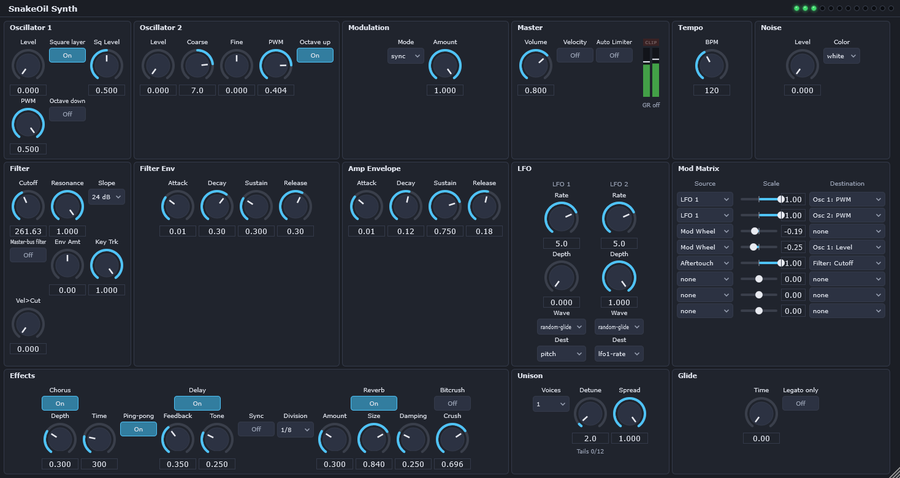

## The sound

I first saw it in a YouTube video of a synthesizer with a Moog-style 24 dB ladder filter, also called a four-pole filter. Turn the resonance all the way up and the filter whistles. I love the sound of the old synthesizers, so I tried to make that whistle with synth plugins in Reaper and Sonar. None of them would do it, and eventually I gave up.

Then I found the Behringer Deepmind 12. Its Moog-style 24 dB ladder filter can self-oscillate and produce a sine wave. I bought it almost immediately and started experimenting.

## A prototype in Python

When AI coding assistants arrived, I decided to try building my own software synth. I started in Python because it already had good audio libraries. I got a prototype that could play simple note sequences from a file, and then let it sit for about a year.

## Handing it to Jilly

Recently my good friend Shannon Duncan, founder of Hackers in the Loop, introduced me to Jilly: a free Discord bot, powered by DeepSeek, that can read, write, and edit code. I gave the project to Jilly, and it produced the first working version. It was rough, lacked features, and used a lot of CPU, but it worked.

I took it home and let Claude Sonnet 5.5 have a go while I tested and we worked out bugs. We switched some libraries, adding SciPy among others, and ended up with a 12-voice polyphonic synthesizer with two oscillators. One has a sawtooth and a square wave. The other is a square wave that the first can modulate.

From there I added feature after feature, throwing in as many ideas as I could, then testing and fixing until I was happy with what it did. It has a resonant filter, envelopes, LFOs, a modulation matrix, unison, and an effects chain.

## Past the limits of Python

Even with SciPy, Python limited the filter. It still could not oscillate at maximum resonance, which was the whole point. So I sent the code back to Jilly and asked it to port the Python application to a VST3 plugin in C++ with JUCE. Jilly did an amazing job on the conversion. I gave the result back to Claude to iron out a couple of bugs, and that produced the plugin as it stands today.

## Where it stands

In the C++ plugin, the filter self-oscillates at maximum resonance, which is the sound I set out to make. As far as I can tell, it is the first free synth plugin of its kind that does that.

*SnakeOil Synth whistling. Both oscillator levels and the noise level are at zero, resonance is at 1.000 on the 24 dB slope, and the master meter still shows output: the filter is oscillating on its own. Click the image to see it full size.*

The plugin builds on Windows, because that is what I use. It is licensed under AGPL-3.0, and anyone can build it from the source on my GitHub. I will upload a 1.0 release when I am satisfied with the plugin and how it functions. The Python version is still in the same repository as the reference the plugin was checked against.
